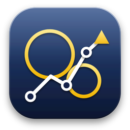

# BMS Cards

Datacard and kneeboard planner for **Falcon BMS 4.38.1**.

Reads campaign files (.cam, .fmap, .twx, Link16, IFF, DTC .ini) and fills the datacard of a chosen flight.
Writes the kneeboard as BMS-compatible DDS files (DXT1, or DXT5 with mipmaps).

## What it does
Pick a campaign and a flight, and the program fills the paperwork for you. Each page is a tab:

- **Datacard** - the flight card: steerpoints, times, fuel, take-off and landing performance, weights, radios, threats. Ready to print or to put in the kneeboard.
- **Data Cartridge** - opens a DTC `.ini`, edits it and writes it back (the first original is kept once in the program folder).
- **Kneeboard** - arranges the cards on the BMS kneeboard pages and writes them as DDS files.
- **Map** - the campaign map with flights, threats and objects; offsets can be placed on the steerpoints.
- **Weapons**, **BVR Timeline**, **Performance**, **Weather** - calculators and views that use the same flight.
- **Squadron** - roster, missions sent from one pilot to the others, logbook and campaign results.
- **Docs** - the reference documents.

Pages that edit something have an Edit switch; with it off they only show.

## Getting started
1. Download the portable folder (see Build below) and put it in a folder you can write to (Documents, `C:\Games`), not in Program Files.
2. Start `BMS Cards.exe`, open **Settings** and choose your Falcon BMS folder (it is found by itself in most cases). The game data is read from your own installation; none of it is shipped here.
3. On the Datacard page choose a campaign, then a flight.
4. Settings, config and your squadrons are kept in the same folder, so moving the folder moves everything. `config.json` is made by the program at the first start.

### A new version
There is no updater, and the download never contains your data. Put the new version in a **new folder** (the old one stays as it is), start it and open **Settings > Import & backup > Import from another version**. Choose the folder of the older version (or a backup file) and the program copies what you want to keep: settings, page preferences, squadrons and your pilot identity, saved missions, kneeboard cards and the saved originals of your DTC and kneeboard files. The older folder is never changed. When it is done, restart the program. The same page has **Export my data**, which saves all of it in one `.zip` backup file that can be imported the same way.

## Squadron and your network address
Pilots of a squadron find each other through public trackers that only pass the connection offers; missions and messages then go **directly from pilot to pilot** (WebRTC). Nothing is stored on a server.

To open that direct connection the other pilots' programs must learn how to reach you, so **the address of your computer on your local network (LAN) and your public IP address are visible to the pilots of the squadron you connect to**. Do not join a squadron you do not trust. Browsers and Windows may hide the LAN address behind a `.local` name; in that case pilots on the same virtual LAN cannot reach each other and the connection goes through the public address. The Squadron page has a connection test.

Once a day the program asks GitHub (api.github.com) whether a newer version exists and shows a notice; nothing is downloaded or installed. It can be switched off in Settings > General.

## Safety
The desktop program only loads its own scripts (Content Security Policy), reads files from your BMS folder and the program folder, and writes only the kinds of files it makes (`.ini`, `.json`, `.dds`, pictures, mission files, the `.zip` backup file). Programs, scripts and system folders are blocked for writing.

## Status
- `app/` - the interface. The game data (aircraft, weapons, objects, airbases, radio, threats) is read from your own Falcon BMS installation (set its folder in Settings): none of it is included.
- `src-tauri/` - Windows desktop shell (Tauri). Portable: one folder with the exe (it makes `config.json` and the other files of your data there).
- `tests/`, `tools/` - the tests. They need private copies of BMS data and of campaign files that are not in the repository, so they run only on the developer's computer.
- `docs/ARCHITECTURE.md` - how the program is built now (short); `docs/archive/ARCHITECTURE-history.md` - the diary of every patch.

## Build
Windows builds are made by GitHub Actions (see `.github/workflows/build.yml`). Download the artifact
`BMS-Cards-portable` from the Actions tab.

Tests (Node 20+): `npm test`.
