# BMS Cards

A mission-planning tool for **Falcon BMS 4.38.1**: it reads your campaign and your own BMS installation and prepares the datacard, the DTC and the kneeboard for the flight you pick.

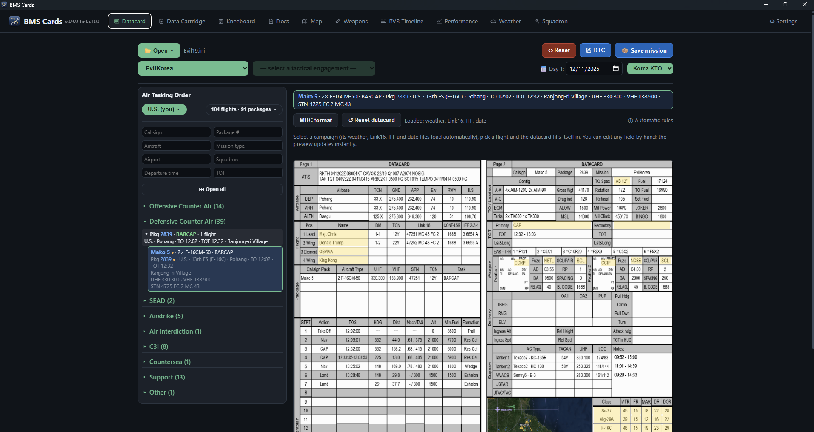

## Read this first

- **I made this for myself.** BMS Cards began as a personal tool and I opened it to the community because it may be useful to others. Many features, and the way they work, follow my own habits and needs, so it may not suit everybody.
- **It is vibe coded.** I'm not a programmer, I'm just a player: I cannot read or write code. The program was written with the help of an AI assistant (Claude, by Anthropic) and tested by me, in the game and on real campaign files. Expect bugs and behaviour I did not intend. Check anything important in the cockpit and in the game before you rely on it.
- **You are free to change it.** The code is open (AGPL-3.0). If you want something different, make a **fork** (the _Fork_ button on GitHub) and bend it as you like. This repository stays my version.

## What it does

Pick a campaign (or a Tactical Engagement) and a flight from the ATO. The program fills in what it can from the files, and you correct what you want: every value on the card can be changed by hand and brought back to automatic.

- **Datacard and MDC** - steerpoints, times, fuel, weights, take-off and landing performance, radios, airbases, threats, IFF and Link 16.
- **Data Cartridge** - opens a DTC `.ini`, edits it (steerpoints, targets, PPTs, lines, avionics settings) and writes it back. The first original of each file is kept in the program folder.
- **Kneeboard** - arranges cards, imported pictures and PDF pages on the kneeboard pages and writes them as DDS files for the theater you fly. The previous files can be restored.
- **Map** - the campaign on a map: flight plans, package, airbases, objectives, units, SAM rings and an estimate of the radar coverage. Offline coastlines for Korea, the Balkans and the Mediterranean theaters, the official BMS map, your own picture, or online satellite and topographic layers.
- **Weapons** - pop-up, HADB, TOSS and HARM geometry, navigation offsets (OA1, OA2, VRP, VIP, pull-up points) that can be placed on the map and written into the DTC.
- **BVR Timeline** - missile range, MAR and the engagement timeline against a target you describe.
- **Performance** - turn and Ps charts, cruise, take-off and landing, fuel plan with joker and bingo.
- **Weather** - the campaign weather drawn on the map, with wind and conditions by altitude.
- **Docs** - the PDFs and charts of the Docs folder of your BMS, with pages you can send to the kneeboard.
- **Squadron** - a squadron profile and roster, missions saved as `.bcrd` files and sent to the other pilots, packages and flights, logbook.
- **ROE / SOP** - rules of engagement and SOP by phase of flight, written in short form on the datacard: your presets and the squadron's, a default for each kind of mission, and a full ROE / SOP card for the kneeboard.
- **Briefing** - a live room on the map for the squadron: the briefer draws, the pilots follow his view, and a kneeboard card keeps the result.

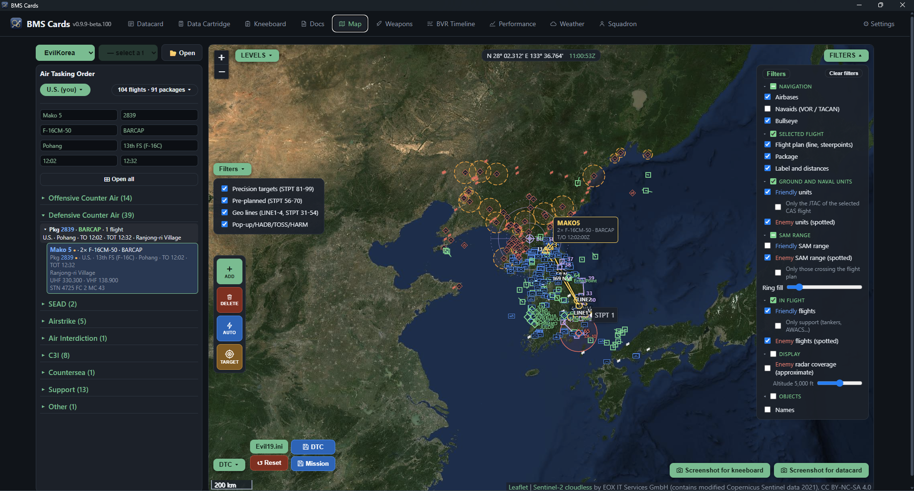
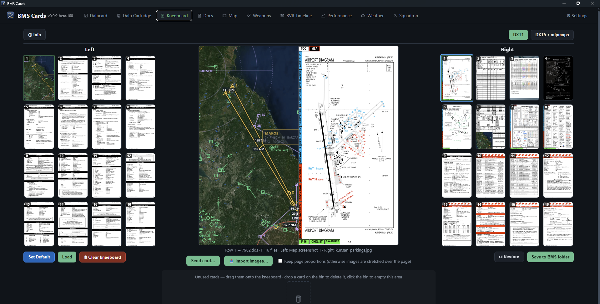
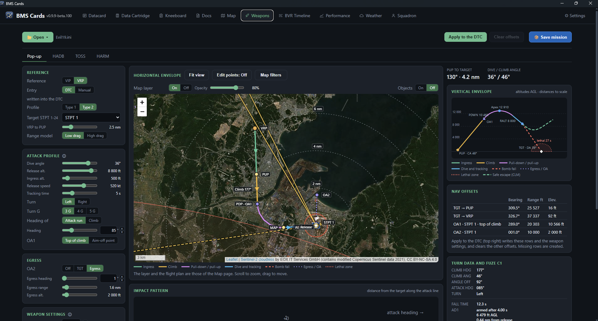
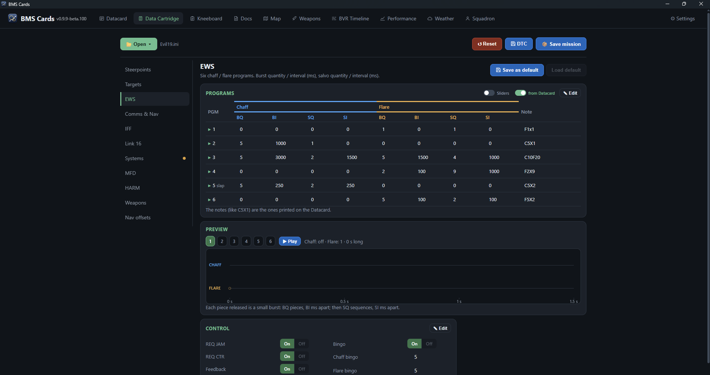

## More screenshots

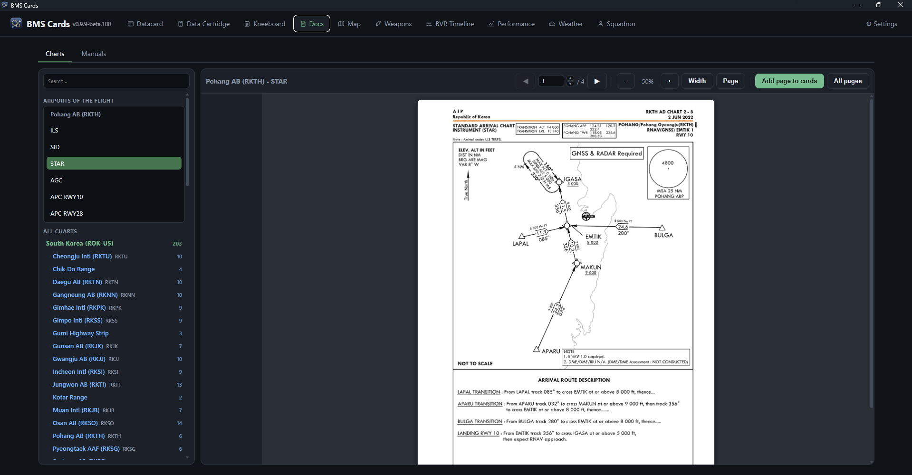
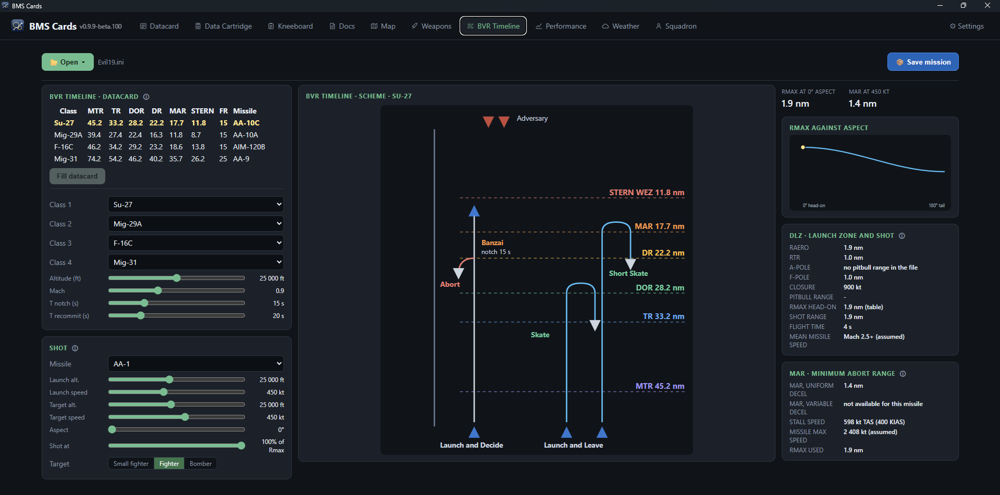
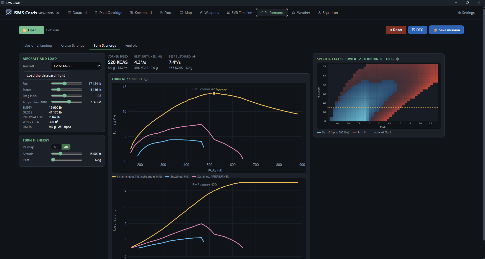
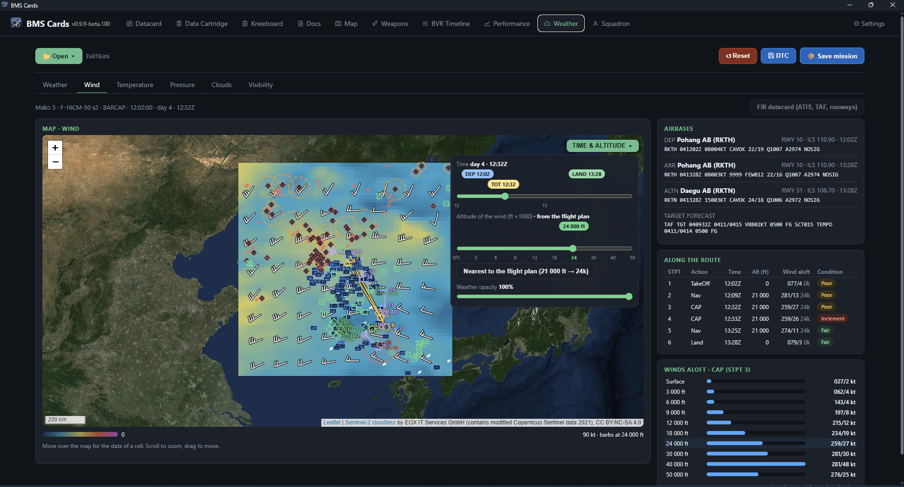
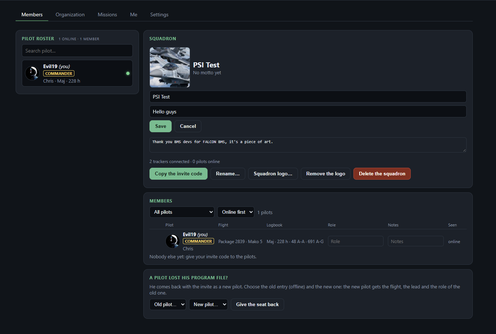
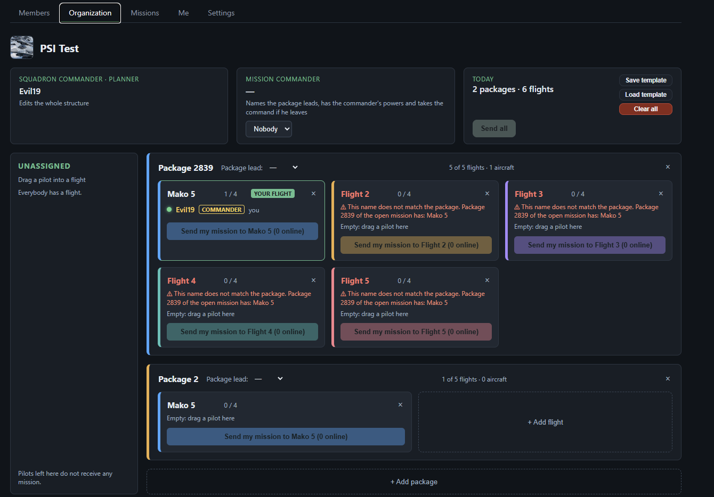

## Getting started

1. Download the latest `BMS-Cards-portable` from the **Releases** page and unzip it into a folder you can write to (Documents, `C:\Games`), **not** Program Files.
2. Start `BMS-Cards.exe`. In **Settings** choose the folder of your Falcon BMS (it is usually found by itself).
3. Choose the theater, then a campaign, then a flight.

The **User Guide** (in the program: **Settings > Help > User Guide**, also as a PDF) explains the idea of the program, the way to a finished datacard in nine steps, the squadron and the technical data in a few pages.

There is no installer and no updater. Settings, squadrons and everything the program saves live in the same folder as the exe, so moving or deleting the folder moves or removes everything.

**Requirements:** Windows and a Falcon BMS installation. Written and tested on **4.38.1**; the program warns when it sees another version.

### A new version

There is no updater, and the download never contains your data. Put the new version in a **new folder** (the old one stays as it is), start it and open **Settings > Import & backup > Import from another version**. Choose the folder of the older version (or a backup file) and the program copies what you want to keep: settings, page preferences, squadrons and your pilot identity, saved missions, kneeboard cards and the saved originals of your DTC and kneeboard files. The older folder is never changed. When it is done, restart the program. The same page has **Export my data**, which saves all of it in one `.zip` backup file that can be imported the same way.

## Limits and known problems

- **Mostly tested on Korea.** The Balkans, the Israel and Hellas theaters work, but with far fewer campaigns and Tactical Engagements tried.
- **Many numbers are estimates.** Missile ranges and MAR, weapon effects, radar coverage and the fuel plan are models of mine, not the game's own code. Performance uses the aircraft data of your BMS: the F-16 and the F-15 are the most carefully checked, the other aircraft are calculated the same way but less verified.
- **Heavy pictures can make it stutter.** Large map pictures and the biggest coastlines can make the window freeze for a moment while the map is drawn. A loading bar is shown when it happens.
- **Squadron was tested with few people.** Missions, the organization and the live briefing have been tried by three pilots at the same time. Connections depend on your network and firewall (the User Guide says what to do when pilots cannot connect), and bugs are likely.
- **Some things are not there.** The game's own briefing is not imported, and some squadron values (experience, morale, supply, mission rating) cannot be read from the files.
- **Writing the DTC and the kneeboard changes your game files.** Keep your own backups too.

## Your network address (Squadron)

Pilots find each other through public trackers that only pass the connection offers; missions and messages then go straight from pilot to pilot (WebRTC), with nothing stored on a server. To make that connection possible the other pilots' programs learn how to reach you: **the address of your computer on your local network and your public IP address are visible to the pilots of the squadron you connect to.** Join squadrons you trust. The Squadron page has a connection test.

## What the program touches

The desktop program only runs its own scripts, reads your BMS folder and its own folder, and writes only the kinds of files it makes (`.ini`, `.json`, `.dds`, pictures, mission files, the `.zip` backup file, the `.pdf` of the User Guide). It never writes programs or scripts. The game data (aircraft, weapons, theaters, airbases, radio) is **read from your own installation at run time and is not part of this repository**.

## For developers

Tauri 2 desktop shell, plain JavaScript for the interface, independent modules for the BMS parsers and the calculations. See [docs/ARCHITECTURE.md](docs/ARCHITECTURE.md) and [docs/ROADMAP.md](docs/ROADMAP.md).

```
npm ci
npm run check
```

Tests that need BMS files skip themselves when the files are not there.

## Thanks

To the **Falcon BMS development team** for the simulator and for the data, manuals and charts that make a tool like this possible, and to the **Falcon BMS community**: the pilots, the tool makers and the people who test and report. Details of the projects that inspired this one and of the third-party components are in [CREDITS.md](CREDITS.md).

BMS Cards is a fan-made project and is **not affiliated with or endorsed by Benchmark Sims**.

## License

GNU Affero General Public License v3.0 (AGPL-3.0). See [LICENSE](LICENSE).
