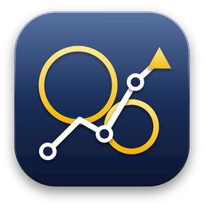

# BMS Cards

Datacard and kneeboard planner for **Falcon BMS 4.38.1**.

Reads campaign files (.cam, .fmap, .twx, Link16, IFF, DTC .ini) and fills the datacard of a chosen flight.
Writes the kneeboard as BMS-compatible DDS files (DXT1, or DXT5 with mipmaps).

## Status
- `app/` - the interface. The game data (aircraft, weapons, objects, airbases, radio, threats) is read from your own Falcon BMS installation (set its folder in Settings): none of it is included.
- `src-tauri/` - Windows desktop shell (Tauri). Portable: one folder with the exe and `config.json`.
- `tests/`, `tools/` - the tests. They need private copies of BMS data and of campaign files that are not in the repository, so they run only on the developer's computer.
- `docs/ARCHITECTURE.md` - how the program is built now (short); `docs/archive/ARCHITECTURE-history.md` - the diary of every patch.

## Build
Windows builds are made by GitHub Actions (see `.github/workflows/build.yml`). Download the artifact
`BMS-Cards-portable` from the Actions tab.

Tests (Node 20+): `npm test`.
